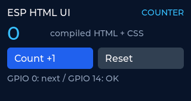

# esp-html-ui

HTML/CSSファイルから、LILYGO T-Display S3向けのUIをコンパイルして作るライブラリ。

**現在は0.1の基礎実装です。** HTML/CSSからLVGL用C++を生成し、T-Display S3向けのファームウェアをビルドできます。入力部品、画像、日本語フォント、Grid、CSSの動的状態などは今後の実装です。



ホスト上のLVGLで描画した表示例です。実機の写真ではありません。

## ゴール

- UIを独立したHTML/CSSファイルで編集する。
- PC上でC++コード・描画用アセットに変換し、ファームウェアに組み込む。
- LVGLで表現できるUIを、HTML/CSSで広く記述できるようにする。
- UIに必要なタグ・CSSを対応表で定義し、表示、入力、配置、状態変化まで扱う。
- 構文解析や描画には既存ライブラリを使い、独自実装を変換・連携部分に集中させる。
- 依存ライブラリ、フォント、画像のライセンスを確認して管理する。

ブラウザと同じ描画結果の再現は完成条件に含めません。対応する構文と描画上の意味を明記します。

## 構成

```text
ui.html + ui.css + 画像・フォント
               ↓ PC上のコンパイラ
        C++コード・描画用アセット
               ↓ ファームウェアのビルド
       LVGL + ディスプレイドライバ
               ↓
         LILYGO T-Display S3
```

ESP32上ではHTML/CSSを解析しません。構文解析はhtml5lib・tinycss2・cssselect2、描画はLVGLに任せています。C++ APIからIDによる要素参照、テキスト更新、クリック通知、表示・無効状態、フォーカスを操作できます。

## 試す

Python 3.10以上と、PlatformIOが対応するホスト環境が必要です。

```sh
python3 -m venv .venv
. .venv/bin/activate
python -m pip install -e . -r requirements-build.txt
python -m platformio run -d examples/counter
```

ビルド前に`examples/counter/ui.html`と`ui.css`からC++が自動生成されます。初回はツールチェーンをダウンロードします。Windowsでは仮想環境の有効化に`.venv\Scripts\Activate.ps1`を使います。

変換だけを試す場合:

```sh
esp-html-ui compile examples/counter/ui.html --output build/generated --name counter
esp-html-ui support
```

## 検証

```sh
python -m unittest discover -s tests -v
python scripts/test_native.py --lvgl examples/counter/.pio/libdeps/t-display-s3/lvgl
```

後者はGCC/G++と`ar`があるLinux環境向けです。実際のLVGLを使い、描画、配置、イベント、フォーカス、画面破棄と再作成を確認します。液晶の発色・向き・実ボタンの動作は実機での確認が必要です。

## ドキュメント

- [仕様・対応範囲案・完成条件](docs/spec.md)
- [実装済みタグ・属性・CSSと今後の対応](docs/support.md)
- [ビルド・書き込み・C++ API](docs/getting-started.md)
- [T-Display S3の実機試験と表示確認サンプル](docs/hardware-testing.md)
- [依存候補とライセンス管理方針](docs/licenses.md)
- [採用した依存のライセンス通知](THIRD_PARTY_NOTICES.md)

全体のゴールは[仕様書](docs/spec.md)、現在使える機能は[対応一覧](docs/support.md)で管理します。最小サンプルの完成を、全体の完成とは扱いません。

## ライセンス

プロジェクト本体のライセンスは未決定です。採用決定後にルートの`LICENSE`へ明記します。依存候補のライセンスは[ライセンス管理方針](docs/licenses.md)に記載しています。
