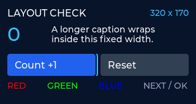

# esp-html-ui

[日本語](README.md) | [English](README.en.md)

HTML/CSSをLVGL用のC++へ変換する、**LILYGO T-Display S3向けのUIコンパイラ**です。
見た目をHTML/CSSで定義し、値の更新やクリック時の処理をC++で記述できます。
HTML/CSSの解析はPC上のビルド時に行い、ESP32では生成コードとLVGLを動かします。

現在は**開発初期のv0.1.0**です。
ラベルとボタンを組み合わせたUIの生成、実機表示、物理ボタンによる操作までを実装しています。
対応するHTML/CSSの範囲は下記の表と[対応一覧](docs/support.md)で確認できます。



実機から回収した320×170の描画データです。液晶の写真ではありません。
実ボタンの操作と表示は、人による確認も行っています。
[実機試験の結果](docs/hardware-results-2026-10-15.md)には、自動診断の数値と確認方法を記録しています。

[クイックスタート](#クイックスタート) / [他のツールとの違い](#他のツールとの違い) / [対応一覧](docs/support.md) / [C++ API](docs/getting-started.md#c-api)

## esp-html-uiを選ぶ理由

**HTML/CSSで見た目を整え、C++で実機を動かす。**
Webの記法でラベルとボタンの画面を編集し、T-Display S3へ組み込みたい用途を想定しています。

- **画面の変更をHTML/CSSの差分で確認できる。** 使い慣れたエディターで構造、色、余白を編集し、CSSの継承や変数でスタイルをまとめられます。
- **アプリの処理をC++で保てる。** HTMLのIDからテキスト更新やクリック通知を扱えます。HTML/CSSの解析はビルド時に済ませ、実機では生成したC++とLVGLを動かします。
- **T-Display S3で試す手順が揃っている。** PlatformIOのビルド前に自動変換し、液晶と物理ボタンの設定を含むサンプルを書き込めます。[自動診断と描画データの回収](docs/hardware-testing.md)も同じリポジトリで実行できます。

## 他のツールとの違い

比較の軸は、画面を記述する形式とアプリへの組み込み方です。
2026年10月15日時点の公式文書をもとに整理しています。

| 選択肢 | 主なUIの記述方法 | アプリへの組み込み方 |
| --- | --- | --- |
| **esp-html-ui** | **対応範囲を定めたHTML/CSS** | **LVGL用C++へ変換。T-Display S3向けPlatformIOサンプルを同梱** |
| [SquareLine Studio](https://docs.squareline.io/docs/introduction/typical_dev/) | GUIでウィジェットとイベントを設定 | LVGL用C/C++などを出力 |
| [EEZ Studio](https://www.envox.eu/studio/studio-introduction/) | ビジュアルエディター。EEZ Flowも選択可能 | LVGL向けの画面を作成し、Flowで処理を記述する構成も選べる |
| [LVGL Pro](https://lvgl.io/docs/pro/integration/using-exported-c-code) | XMLをエディターやCLIで扱う | XMLからLVGL用Cを生成 |
| [lvgljs](https://github.com/lvgl/lv_binding_js) | JavaScriptとReactの考え方による記述 | JavaScript実行環境とLVGLバインディングを使う |

コード生成やCLIによる自動化は他のツールにもあります。
esp-html-uiは、**HTML/CSSを入力にして、C++の操作処理とT-Display S3のビルドにつなぐ流れ**に重点を置いています。
現在の用途はラベルとボタンを中心とした画面です。
画像、多言語表示、豊富な入力部品、GUI上での編集が必要な場合は、各ツールの対応機能も検討してください。
HTML/CSSを扱うEvueとの違い、各ツールの選び方、確認した公式資料は[詳しい比較](docs/comparison.md)にまとめています。

## できること

| 分類 | 現在の対応 |
| --- | --- |
| 画面の構造 | `div`、`section`、`header`、`nav`などのコンテナー |
| 文字と操作 | 見出し、ラベル、`button`。表示文字は印字可能ASCIIと改行、タブ |
| 配置 | 幅と高さ、余白、間隔、Flexの方向、折り返し、整列 |
| スタイル | 色、背景、枠、角丸、不透明度、同梱フォントのサイズ、文字の折り返しと省略 |
| CSSの解決 | 静的なセレクター、詳細度、継承、`!important`、カスタムプロパティと`var()` |
| C++との連携 | IDによる参照、テキスト更新、クリック通知、表示と無効状態の変更、フォーカス操作 |
| ビルド時の診断 | 未対応のタグ、属性、CSSのプロパティや値をコンパイル時に診断 |

**HTML/CSSは対応範囲を定めてLVGLへ変換します。**
レイアウトの既定値や文字の配置はLVGLに従い、ブラウザと同じ描画結果になるとは限りません。
JavaScriptは実行せず、操作時の処理はC++側で実装します。

現時点では、日本語フォント、画像、テキスト入力や選択部品、Grid、動的なCSS擬似クラス、CSSアニメーションは未対応です。
対応する値や単位、ブラウザとの違いは[対応一覧](docs/support.md)、今後の設計案は[仕様書](docs/spec.md)を参照してください。

## クイックスタート

### 必要なもの

- 標準の**LILYGO T-Display S3**（ST7789液晶、170×320）。サンプルは横向き320×170で表示します。
- データ通信に対応したUSBケーブル。
- Python 3.10以上とGit。
- 初回の依存ライブラリとツールチェーンのダウンロードに使うインターネット接続。

このリポジトリのボード設定と実機試験は、標準のT-Display S3を対象にしています。
AMOLED版など別のディスプレイを搭載したモデルには、別の設定が必要です。

### 1. 開発環境を用意する

macOS / Linux:

```sh
git clone https://github.com/MasafumiYamaguchi/esp-html-ui.git
cd esp-html-ui
python3 -m venv .venv
. .venv/bin/activate
python -m pip install -e . -r requirements-build.txt
```

<details>
<summary>Windows（PowerShell）</summary>

```powershell
git clone https://github.com/MasafumiYamaguchi/esp-html-ui.git
cd esp-html-ui
py -3 -m venv .venv
.\.venv\Scripts\Activate.ps1
python -m pip install -e . -r requirements-build.txt
```

</details>

PythonのコンパイラとPlatformIOを同じ仮想環境へインストールします。
Arduinoフレームワーク、LVGL、液晶ドライバは、次のビルド時にPlatformIOが取得します。
以降のコマンドは、仮想環境を有効にした状態でリポジトリのルートから実行してください。

### 2. サンプルをビルドする

```sh
python -m platformio run -d examples/counter
```

ビルド前に`ui.html`と`ui.css`を検証し、LVGL用C++を自動生成します。
初回はツールチェーンの取得とライブラリのコンパイルに時間がかかります。
入力が対応範囲外の場合は、コンパイラが理由を表示し、ビルドを中止します。

### 3. USB接続した実機へ書き込む

```sh
python -m platformio device list
python -m platformio run -d examples/counter -t upload
```

複数の機器を接続している場合は、一覧で確認したポートを`--upload-port`で指定してください。
指定例は`--upload-port /dev/cu.usbmodem2101`（macOS）、`--upload-port COM3`（Windows）です。

起動すると、値が0で「Count +1」が選択されたカウンター画面を表示します。
起動後に、次の2つの物理ボタンで操作できます。

| GPIO | 操作 |
| --- | --- |
| GPIO 0 | 次のボタンへフォーカスを移す |
| GPIO 14 | 選択中のボタンを押す |

GPIO 14で加算し、GPIO 0で「Reset」を選び、もう一度GPIO 14を押すと0に戻ります。

## HTML/CSSを編集する

まずはサンプルの文字、色、余白、配置を変えて、同じビルドコマンドを再実行してください。
HTML/CSSからの生成はビルド前に毎回行い、生成コードをファームウェアへ組み込みます。

| サンプル | 確認できること | 編集するファイル |
| --- | --- | --- |
| [counter](examples/counter) | 加算、リセット、フォーカス移動 | [ui.html](examples/counter/ui.html)、[ui.css](examples/counter/ui.css) |
| [layout-check](examples/layout-check) | 長文の折り返し、RGBの文字色、ボタン配置 | [ui.html](examples/layout-check/ui.html)、[ui.css](examples/layout-check/ui.css) |

冒頭の表示確認サンプルを書き込む場合:

```sh
python -m platformio run -d examples/layout-check -t upload
```

HTMLの`id`を使って、C++側から要素を参照できます。
操作時の処理は[カウンターのC++実装](examples/counter/src/main.cpp)、APIの契約と要素の寿命は[C++ APIの説明](docs/getting-started.md#c-api)を参照してください。
表示確認サンプルは同じC++実装を共有し、HTML/CSSを差し替えています。

## 変換の流れ

```text
ui.html + ui.css
       ↓ PC上で構文解析、CSSの解決、対応範囲の検証
生成したC++ + JSONの生成記録
       ↓ PlatformIOでコンパイル
ESP32上のLVGL + TFT_eSPI
       ↓
T-Display S3の液晶と物理ボタン
```

HTML解析にはhtml5lib、CSS解析にはtinycss2、セレクター照合にはcssselect2を使います。
生成した画面の描画とレイアウト、入力はLVGLが担当し、液晶への転送にはTFT_eSPIを使います。

実機を接続せず、HTML/CSSからの変換だけを試すこともできます。

```sh
esp-html-ui compile examples/counter/ui.html --output build/generated --name counter
esp-html-ui support
```

前者は`counter.h`、`counter.cpp`、`counter.json`を生成します。
JSONには入力のハッシュ、コンパイラと解析ライブラリの版、要素のID、フォント一覧を記録します。
`support`は現在の対応範囲と今後の項目をJSONで表示します。

## 検証

コンパイラと試験ツールのテストは、実機なしで実行できます。

```sh
python -m unittest discover -s tests -v
```

2026年10月15日の実機試験では、標準カウンターの26項目、表示確認サンプルの31項目が通過しました。
1万回のクリックイベント、1000回の画面作成と破棄、液晶メモリの読み戻し、連続操作、3回のソフトウェア再起動を確認しています。
物理ボタンの手押しと液晶表示についても、人による正常確認を得ています。
試験条件と確認範囲は[実施結果](docs/hardware-results-2026-10-15.md)、再実行方法は[実機試験手順](docs/hardware-testing.md)にまとめています。

実際のLVGLを使うホスト上の描画試験も用意しています。
必要なツールと実行方法は[ビルドと使い方](docs/getting-started.md#ホスト上での検証)を参照してください。

## ドキュメント

| ドキュメント | 内容 |
| --- | --- |
| [ビルドと使い方](docs/getting-started.md) | セットアップ、生成ファイル、固定した主要依存、C++ API |
| [現在の対応状況](docs/support.md) | タグ、属性、CSSの値と制約、ブラウザとの違い |
| [他のUI開発ツールとの比較](docs/comparison.md) | 記述形式、コード生成と実行方式、用途ごとの選び方 |
| [仕様と完成条件](docs/spec.md) | プロジェクトの目標と今後の設計案 |
| [T-Display S3の実機試験](docs/hardware-testing.md) | 診断用ファームウェア、ログと画像の回収、手押し試験 |
| [実機試験の結果](docs/hardware-results-2026-10-15.md) | 測定値、描画画像、人による確認結果 |
| [依存ライブラリとライセンス管理](docs/licenses.md) | 採用した依存と配布に向けた確認範囲 |
| [Third-party notices](THIRD_PARTY_NOTICES.md) | 依存ライブラリとフォントのライセンス通知 |

## 不具合の報告

[GitHub Issues](https://github.com/MasafumiYamaguchi/esp-html-ui/issues)へ、使用したコミット、OSとPythonの版、基板のモデル、実行したコマンド、エラーログを添えて報告してください。
変換や配置の問題では、再現に必要な最小のHTML/CSSと、期待する結果もあると確認しやすくなります。
実機から回収した描画データと液晶の写真は、それぞれを区別して添付してください。

## ライセンス

プロジェクト本体は[MIT License](LICENSE)で公開しています。
コンパイラ、C++ランタイム、本プロジェクトが作成したサンプルとドキュメントを含みます。

依存ライブラリとフォントの通知は[THIRD_PARTY_NOTICES.md](THIRD_PARTY_NOTICES.md)に保存しています。
ファームウェア全体の配布に向けたライセンス確認は継続中で、ファームウェアバイナリのリリースは行っていません。
詳細は[ライセンス管理](docs/licenses.md)を参照してください。
