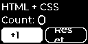

# ディスプレイへの組み込み

[日本語](displays.md) | [English](displays.en.md)

コンパイラとC++ランタイムはLVGLのAPIを使い、特定の基板やディスプレイドライバには依存しない。
ボードごとの初期化、表示転送、入力の接続はアプリ側で行う。

| サンプル | 基板とディスプレイ | 解像度 | 確認範囲 |
| --- | --- | --- | --- |
| [counter](../examples/counter)、[layout-check](../examples/layout-check) | LILYGO T-Display S3、ST7789、TFT_eSPI | 320×170、RGB565 | ビルド、ホスト描画、実機表示と物理ボタン |
| [ssd1306](../examples/ssd1306) | ESP32 Dev Module、I²C SSD1306、Adafruit SSD1306 | 128×64、白黒 | ビルド、ホスト描画、画素変換、値更新とフォーカス。OLED実機は未確認 |

## SSD1306を使う



これはホスト上で描画し白黒へ変換したプレビューであり、OLED実機の写真や取得画像ではない。

リポジトリの[開発環境](getting-started.md#セットアップ)を用意する。
サンプルは標準のESP32 Dev Moduleを対象にしており、T-Displayを必要としない。

### 配線と設定

3.3Vで使えるI²C SSD1306モジュールを接続する。
既定の配線は次のとおり。

| OLED | ESP32 |
| --- | --- |
| GND | GND |
| VCC | 3V3 |
| SDA | GPIO 21 |
| SCL | GPIO 22 |

[platformio.ini](../examples/ssd1306/platformio.ini)の`board`と`build_flags`を、使用する基板と配線に合わせる。
既定値は`OLED_SDA=21`、`OLED_SCL=22`、`OLED_ADDRESS=0x3C`、`OLED_RESET=-1`。
リセット端子を使う場合は、そのGPIOを`OLED_RESET`に指定する。
起動時には指定アドレスのACKを確認し、応答がなければシリアルへ診断を出す。
ACKだけでコントローラーの型番までは判別できない。

このサンプルはSSD1306の128×64版用である。
SH1106やSPI接続、128×32版には、それぞれに合うドライバ設定と画面レイアウトが必要になる。

### ビルドと操作

仮想環境を有効にし、リポジトリのルートで実行する。

```sh
python -m platformio run -d examples/ssd1306
python -m platformio run -d examples/ssd1306 -t upload
python -m platformio device monitor -d examples/ssd1306
```

複数の機器がある場合は、書き込みコマンドに`--upload-port`を付けて指定する。
モニターは115200 baudで開く。
`n`を送ると次のボタンへ移り、`e`を送ると選択中のボタンを実行する。
初期状態は「+1」を選択している。
`e`で加算し、`n`、`e`でResetを実行できる。
このサンプルの操作はシリアル入力を使うため、外付けボタンは不要である。

### 白黒描画の方式

HTML/CSSは他のサンプルと同じコンパイラで処理する。
OLED用のレイアウトと白黒の配色は[ui.css](../examples/ssd1306/ui.css)で定義している。
LVGLはL8形式のグレースケールで画面全体を描き、転送時に輝度128以上を点灯へ変換する。
色や半透明も最終的には白黒になるため、白と黒の配色を基本にする。

LVGLの行単位の画素を、SSD1306の8行単位のページ配置へ変換して送る。
128×64ではLVGLの描画バッファが8192 bytes、ドライバの白黒バッファが1024 bytesであり、別途LVGLのオブジェクトやヒープを使う。
L8を経由するのは、固定しているLVGL 9.4.0のI1描画でアンチエイリアス付きの白文字が欠けることをホスト画像で確認したためである。

## 他のディスプレイへ移植する

1. PlatformIOの基板、LVGL 9.4.0、表示ドライバ、`config/lv_conf.h`を用意する。
2. `custom_ui_name`、`custom_ui_width`、`custom_ui_height`で生成する名前空間と解像度を指定する。
3. LVGLの表示を作り、ドライバに合う色形式、描画バッファ、転送コールバックを設定する。
4. 生成UIを作成する。転送コールバック内では、転送完了後に`lv_display_flush_ready()`を呼ぶ。
5. タイマーと必要な入力デバイスを接続する。

共通の[ビルド前フック](../scripts/platformio_codegen.py)は`examples/<project>/`の構成を想定する。
設定を省略した場合は名前`counter`、幅320、高さ170を使う。
出力先は`generated/<environment>/<name>/`で、異なる環境や名前の生成物を分離する。
独立したアプリへ組み込む場合は、CLIで生成したC++と`runtime/`をアプリのビルドへ追加してもよい。
解像度はLVGLの表示と生成UIで一致させ、画面の寸法に合わせてHTML/CSSも調整する。

## 実機なしの確認

サンプルを一度ビルドしてLVGLを取得した後に実行する。
GCC/G++または互換のClangと`ar`が必要になる。

```sh
python -m unittest discover -s tests -v
python scripts/test_native.py --lvgl examples/ssd1306/.pio/libdeps/esp32-ssd1306/lvgl --example ssd1306
```

ホスト試験では128×64内の配置、グレースケール描画、白黒の閾値、ページ配置、値更新、クリック、フォーカスを検証する。
描画結果は`.build/native/ssd1306/ssd1306.pbm`に保存する。
I²C転送、配線、実際のOLEDの表示はこの試験の対象外である。

参照: [LVGLの色形式](https://lvgl.io/docs/open/9.4/details/main-modules/display/color_format.html)、[Adafruit SSD1306のAPI](https://adafruit.github.io/Adafruit_SSD1306/html/class_adafruit___s_s_d1306.html)。
