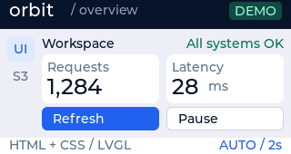

# Orbit web dashboard



この画像はLVGLによるホスト描画であり、液晶の写真ではありません。
This image is rendered by LVGL on the host, rather than photographed from the display.

## 日本語

T-Display S3の320×170画面に、ヘッダー、サイドバー、数値カード、操作ボタンを配置するサンプルです。
見た目は[ui.html](ui.html)と[ui.css](ui.css)、デモ値の更新とイベント処理は[DashboardDemo.h](src/DashboardDemo.h)で定義しています。
RequestsとLatencyはデモ値であり、ネットワークやセンサーの測定値ではありません。

リポジトリの開発環境を用意し、ルートから実行します。

```sh
python -m platformio run -d examples/web-dashboard -t upload --upload-port /dev/cu.usbmodem2101
```

ポートは接続環境に合わせて指定してください。
このサンプルはUSB接続時の切断を避けるため、`upload_flags = --no-stub`でROMの書き込み機能を使います。
GPIO0でRefresh／Pauseの選択を切り替え、GPIO14で実行します。
初期状態では2秒ごとにデモ値を更新します。
Refreshは即時更新、Pauseは自動更新の停止、Resumeは再開です。
一時停止中もRefreshを使えます。

ホスト上での配置と操作の確認:

```sh
python scripts/test_native.py --lvgl examples/counter/.pio/libdeps/t-display-s3/lvgl --example web-dashboard
```

描画結果は`.build/native/web-dashboard/dashboard.ppm`に保存します。
表示と物理ボタンを初期化する部分は[main.cpp](src/main.cpp)にあります。

2026年10月16日にT-Display S3へ書き込み、起動と値の自動更新をログで確認しました。
表示と物理ボタンの操作は、利用者が正常確認済みです。

## English

A 320 × 170 T-Display S3 example with a navigation header, sidebar, metric cards, and action buttons.
Edit the appearance in [ui.html](ui.html) and [ui.css](ui.css); [DashboardDemo.h](src/DashboardDemo.h) handles demo data and events.
Requests and Latency are simulated values, rather than network or sensor measurements.

Set up the repository's development environment, then run the upload command above from the repository root.
Adjust the upload port for your device.
The sample sets `upload_flags = --no-stub` to use the ROM loader and avoid USB disconnections with the temporary upload stub.
GPIO0 switches focus between Refresh and Pause; GPIO14 activates the focused button.
Demo values update every two seconds by default.
Refresh updates immediately, Pause stops automatic updates, and Resume restarts them.
Refresh also works while paused.

The host test command above checks rendering, widget bounds, timed updates, refresh, pause/resume, and focus.
It saves `.build/native/web-dashboard/dashboard.ppm`.
Display and physical button initialization are in [main.cpp](src/main.cpp).

On October 16, 2026, the example was flashed to a T-Display S3, and logs confirmed startup and automatic value updates.
The user also confirmed normal display output and physical button operation.
